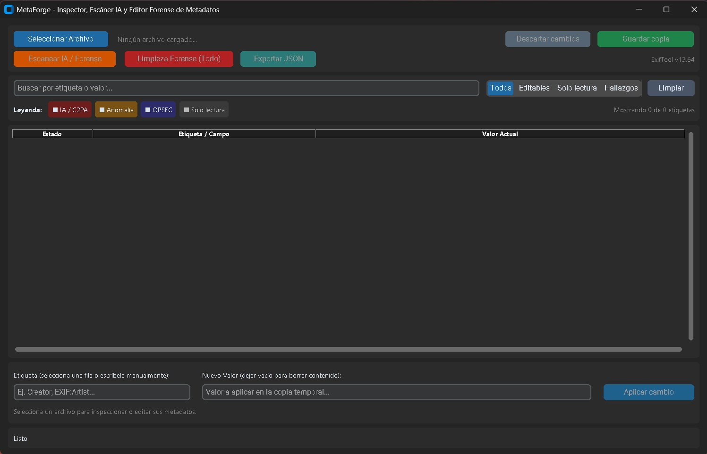

# MetaForge

MetaForge es una herramienta forense de código abierto escrita en Python para inspeccionar, analizar, editar y purgar metadatos de imágenes, archivos multimedia, documentos de Microsoft Office (`.docx`, `.xlsx`, `.pptx`) y archivos PDF. Incluye un escáner forense para detectar firmas de Inteligencia Artificial y credenciales C2PA, anomalías estructurales y fugas de privacidad (OPSEC), trabajando siempre con copias no destructivas (`_procesado`) para mantener intacto el archivo original.



## Características principales

* **Flujo no destructivo (`_procesado`):** El archivo original nunca se sobrescribe. Al aplicar el primer cambio se crea una copia temporal privada y el resultado se exporta únicamente al pulsar **Guardar copia** como `<nombre>_procesado<ext>` (o `_procesado_1`, `_procesado_2`, ... si ya existe).
* **Motor OOXML seguro para Office:** Permite editar y limpiar propiedades estándar (`core.xml`, `app.xml`), eliminar fechas (`CreateDate`, `ModifyDate`, `LastPrinted`), vaciar propiedades personalizadas (`docProps/custom.xml` -> `<Properties/>`) sin dañar el documento y sanear caracteres Unicode invisibles en `.docx`, `.xlsx` y `.pptx`.
* **Escáner forense y de IA calibrado:** Identifica firmas de IA/C2PA (`[IA]`), exportadores programáticos y anomalías temporales (`[Anomalía]`) y fugas de identidad/ubicación (`[OPSEC]`), diferenciando campos editables de campos de solo lectura.
* **Advertencia explícita en PDF:** Muestra una franja fija de advertencia mientras haya un archivo PDF abierto y solicita confirmación explícita antes de limpiar, informando que ExifTool realiza borrado incremental en PDF.
* **Interfaz responsiva multiplataforma:** Compatible con **Windows 11** y **Kali Linux** (Python 3.10+), con ejecución en segundo plano sin congelar la ventana y búsqueda/filtrado en tiempo real por etiqueta y valor.

## Requisitos previos e instalación

Para ejecutar MetaForge necesitas **Git**, **Python 3.10 o superior** y **ExifTool**.

### Instalación en Windows 11

1. **Instalar Git y Python:**
   * Descarga Git desde [git-scm.com](https://git-scm.com/download/win) e instálalo con las opciones predeterminadas.
   * Descarga Python desde [python.org](https://www.python.org/downloads/). En la primera pantalla del instalador marca la casilla **"Add python.exe to PATH"** antes de pulsar *Install Now*.

2. **Clonar el repositorio:**
   ```powershell
   git clone https://github.com/ClasK7/MetaForge.git
   cd MetaForge
   ```

3. **Descargar y colocar ExifTool local en `bin/`:**
   Por higiene del repositorio, los ejecutables de Windows no se incluyen en GitHub.
   * Descarga el paquete **Windows Executable** (64-bit) desde [exiftool.org](https://exiftool.org/).
   * Descomprime el archivo descargado. Dentro verás `exiftool(-k).exe` y la carpeta `exiftool_files/`.
   * Crea una carpeta `bin` en la raíz del proyecto (`MetaForge\bin\`).
   * Renombra `exiftool(-k).exe` a `exiftool.exe` y cópialo dentro de `MetaForge\bin\` **junto con la carpeta completa `exiftool_files\`**:
     ```text
     MetaForge/
     └── bin/
         ├── exiftool.exe
         └── exiftool_files/
     ```

4. **Crear entorno virtual e instalar dependencias:**
   ```powershell
   python -m venv venv
   .\venv\Scripts\activate
   pip install -r requirements.txt
   ```
   > **Nota si PowerShell bloquea `activate`:** Si ves un error de directiva de ejecución (`ExecutionPolicy`), puedes usar CMD (`venv\Scripts\activate.bat`) o ejecutar directamente sin activar el entorno:
   > ```powershell
   > .\venv\Scripts\pip.exe install -r requirements.txt
   > .\venv\Scripts\python.exe main.py
   > ```

5. **Iniciar la aplicación:**
   ```powershell
   python main.py
   ```

### Instalación en Kali Linux (Debian / Ubuntu)

1. **Instalar dependencias del sistema (incluyendo ExifTool y Tkinter):**
   ```bash
   sudo apt update && sudo apt install -y git python3 python3-venv python3-pip python3-tk libimage-exiftool-perl
   ```

2. **Clonar el repositorio y crear el entorno virtual:**
   ```bash
   git clone https://github.com/ClasK7/MetaForge.git
   cd MetaForge
   python3 -m venv venv
   source venv/bin/activate
   pip install -r requirements.txt
   ```

3. **Iniciar la aplicación:**
   ```bash
   python main.py
   ```

### Solución de errores comunes al arrancar

* **`ExifTool no disponible` en Windows 11:** Comprueba que `bin\exiftool.exe` esté renombrado (sin `(-k)`) y que la carpeta `bin\exiftool_files\` se encuentre exactamente al lado del ejecutable.
* **`ExifTool no disponible` en Kali Linux:** Ejecuta `sudo apt update && sudo apt install -y libimage-exiftool-perl` y verifica con `exiftool -ver`.
* **`No se pudo cargar la interfaz gráfica` (`ModuleNotFoundError: tkinter`) en Kali Linux:** Instala Tkinter del sistema con `sudo apt install -y python3-tk`.

## Guía de uso paso a paso

1. **Cargar un archivo:** Pulsa **Seleccionar Archivo**. La lectura se realiza en segundo plano sin copiar ni alterar el archivo original.
2. **Buscar y filtrar etiquetas:**
   * Usa la caja de búsqueda para filtrar en tiempo real tanto por el nombre de la etiqueta como por su valor.
   * Usa los filtros rápidos (**Todos**, **Editables**, **Solo lectura**, **Hallazgos**) y el botón **Limpiar** para restablecer la vista.
3. **Interpretar la columna `Estado` y la leyenda:**
   * `[IA]` (rojo oscuro): Firma explícita de herramienta de IA generativa, credenciales C2PA/JUMBF o caracteres Unicode invisibles en documentos Office.
   * `[Anomalía]` (ámbar): Exportadores programáticos (`python-docx`, `Pandoc`, `ReportLab`, etc.) o inconsistencias temporales/estructurales.
   * `[OPSEC]` (azul): Datos personales, autoría, equipo, dispositivo o coordenadas GPS.
   * `[Solo lectura]` (gris): Campos calculados, binarios, estructuras compuestas o grupos no modificables (`File`, `ZIP`, `JUMBF`, etc.). Al seleccionar una fila de solo lectura, la edición inferior se bloquea automáticamente.
4. **Editar una etiqueta manualmente:**
   * Selecciona una fila editable (o escribe el nombre de una etiqueta editable en el campo inferior), ingresa el nuevo valor (o déjalo vacío para borrarlo) y pulsa **Aplicar cambio**.
   * Para fechas en documentos Office (`CreateDate`, `ModifyDate`, `LastPrinted`), usa formato ISO 8601 (`YYYY-MM-DDTHH:MM:SSZ`) o déjalo vacío para eliminar la fecha.
   * El cambio se aplica sobre la copia temporal de trabajo; el contador en **Guardar copia (N)** indica cuántos cambios están pendientes.
5. **Escanear IA / Forense y limpieza selectiva:**
   * Pulsa **Escanear IA / Forense** para resaltar los hallazgos en la tabla y abrir la ventana de reporte detallado (indicando qué hallazgos son `[Editable]` y cuáles son `[Solo informativo]`).
   * Si hay hallazgos editables, puedes pulsar **Limpiar Solo Hallazgos Editables** para sanearlos en la copia temporal.
6. **Limpieza Forense (Todo):**
   * Pulsa **Limpieza Forense (Todo)** y confirma el diálogo para purgar todos los metadatos editables sobre la copia temporal.
7. **Descartar cambios o Exportar JSON:**
   * **Descartar cambios** elimina la copia temporal y restaura los metadatos originales en pantalla.
   * **Exportar JSON** guarda los metadatos actualmente visibles en un archivo `.json` UTF-8.
8. **Exportar el archivo final (`Guardar copia`):**
   * Pulsa **Guardar copia** para generar `<nombre>_procesado<ext>` en la misma carpeta del archivo original (si ya existe, o si el original ya terminaba en `_procesado`, generará `_procesado_1`, `_procesado_2`, etc. sin sobrescribir nada).
   * Si la carpeta original es de solo lectura (por ejemplo, una unidad de evidencia protegida), MetaForge abrirá un selector para que elijas otra carpeta de destino.
   * Una vez guardada la copia, el archivo original permanece intacto, la copia temporal se elimina y la vista regresa al estado original del archivo inicial.

## Limitaciones conocidas

* **Archivos PDF:** ExifTool aplica actualizaciones incrementales al limpiar o editar archivos PDF; los metadatos anteriores se ocultan en lectores estándar pero pueden seguir recuperables dentro del binario. MetaForge muestra una franja fija de advertencia y solicita confirmación explícita al limpiar un PDF. Para una purga irreversible se requiere re-exportar o linealizar el PDF con una herramienta dedicada (como `qpdf`).
* **Documentos Office (`.docx`, `.xlsx`, `.pptx`):** La limpieza total purga `docProps/core.xml` (incluyendo `CreateDate`, `ModifyDate` y `LastPrinted`), `docProps/app.xml`, vacía `docProps/custom.xml` dejando un `<Properties/>` válido y limpia caracteres Unicode invisibles en el texto del documento. Los metadatos del sistema de archivos (`File:*`), miniaturas (`docProps/thumbnail.*`), comentarios y control de cambios no se modifican.

## Pruebas automatizadas y diagnóstico

* **Ejecutar la suite completa de pruebas unitarias (sin dependencias externas ni entorno gráfico):**
  ```bash
  python -m unittest discover -s tests -v
  ```
* **Ejecutar en modo diagnóstico (sin volcar valores de metadatos personales en el registro):**
  ```bash
  python main.py --debug
  ```

## Licencia

Este proyecto se distribuye bajo la licencia **GNU General Public License v3.0 (GPLv3)**. Consulta el archivo [LICENSE](LICENSE) para más detalles.
