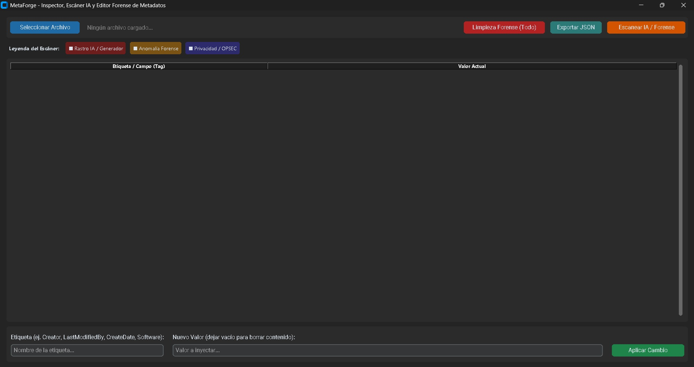

# MetaForge 

MetaForge es una herramienta forense de código abierto construida en Python para inspeccionar, inyectar y purgar metadatos de imágenes, documentos de Office (.docx, .xlsx, .pptx) y multimedia. Incluye un escáner heurístico para detectar anomalías OPSEC y rastros de herramientas de Inteligencia Artificial (C2PA, metadatos generativos, y caracteres Unicode invisibles).



### 0. Requisitos Previos (Si es tu primera vez)

Para poder descargar y ejecutar esta herramienta, tu computadora necesita dos programas básicos: **Git** y **Python**.

**En Windows:**

* **Git:** Descarga el instalador desde [git-scm.com](https://git-scm.com/download/win) e instálalo dejando todas las opciones por defecto (solo haz clic en "Next" hasta terminar).

* **Python:** Descarga la última versión desde [python.org](https://www.python.org/downloads/). **⚠️ MUY IMPORTANTE:** Al abrir el instalador, fíjate en la primera pantalla, abajo del todo. **Debes marcar la casilla que dice "Add Python to PATH"** (o "Add python.exe to PATH") antes de hacer clic en "Install Now". Si no marcas esto, los comandos no funcionarán.

**En Linux (Ubuntu/Debian/Kali):**
Abre tu terminal y ejecuta este comando para instalar todo lo necesario de golpe:

```
sudo apt update && sudo apt install git python3 python3-venv python3-pip

```

## Instalación y Ejecución

1. **Clonar el repositorio:**
   ```bash
   git clone https://github.com/ClasK7/MetaForge.git

   cd MetaForge
2. **Crear y activar un entorno virtual:**

   * **En Windows (PowerShell/CMD):**
     ```cmd
     python -m venv venv

     .\venv\Scripts\activate
     ```

   * **En Linux:**
     ```bash
     python3 -m venv venv

     source venv/bin/activate
     ```

3. **Instalar dependencias:**
   ```bash
   pip install -r requirements.txt
   ```

4. **Lanzar la aplicación:**
   ```bash
   python main.py
   ```